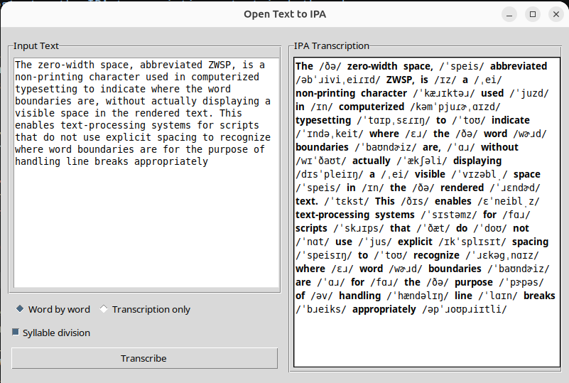

<div align="center">
  <p>
    
    <strong><big>Open Text to IPA</big></strong>
    
  </p>
  <p><strong>English text and IPA transcription, together in one readable view.</strong></p>
</div>

<div align="center">
  
</div>

## Project intent and attribution

This project is intended as a practical, free-to-use tool, not as an educational product. It was developed with AI assistance. Its contribution is a simple side-by-side interface for transcribing long passages while preserving their formatting; pronunciation data and phonetic processing come from the cited PySLE engine and ISLE dictionary.

The goal is to offer a free, local alternative for the combined text-and-transcription workflow found on [toIPA.org](https://toipa.org/text-to-ipa/en-US/). This project is independent and is not affiliated with toIPA.org.

The `lingose` Python package was also considered, but it does not provide the syllable boundaries and stress marks required for this app. PySLE was selected because syllabic separation and lexical stress are essential to the intended output.

### Engine citation

The phonetic engine is **PySLE**, a Python interface to the ISLE pronunciation dictionary. Its author describes the package as an interface to a pronunciation dictionary with stress markings and tools for working with pronunciations.

> Mahrt, T. (2016). *Pysle*. https://github.com/timmahrt/pysle

PySLE’s bundled pronunciation data is the ISLE dictionary. See the [ISLEX project](https://github.com/uiuc-sst/g2ps) for the dictionary source and its attribution.

## Installation

1. **Create a virtual environment** (Python 3.11+):
   ```bash
   python3 -m venv ~/venv
   source ~/venv/bin/activate
   ```

2. **Install dependencies**:
   ```bash
   pip install -r requirements.txt
   ```

3. **Run the application**:
   ```bash
   python main.py
   ```

## Usage

1. Paste English text into the left text area.
2. Choose a transcription mode (the default is **Word by word**):
   - **Word by word**: Each word and its IPA transcription appear together on the same line
   - **Transcription only**: A single continuous IPA line for the whole text
3. "Syllable division" is enabled by default; uncheck it to remove dot separators between syllables.
4. Click "Transcribe" to convert the text to IPA.
5. Use standard shortcuts in the input:
   - **Ctrl+A**: Select all
   - **Ctrl+C / Ctrl+X / Ctrl+V**: Copy / cut / paste
   - **Ctrl+Z / Ctrl+Y**: Undo / redo
6. In the output, **Ctrl+A** selects all and **Ctrl+C** copies the selection. Right-click either text area for its available editing actions.

## Features

- **Long text support**: Scrollable input and transcription panels for longer passages
- **Preserved formatting**: Existing spaces and line breaks are kept in the transcription
- **Stress marking**: Stressed syllables are always marked with `ˈ` or `ˌ`
- **Error handling**: Unknown words are shown in brackets `[word]`
- **Offline**: Uses PySLE locally; no AI service or network connection is used at runtime
- **Cache**: In-memory cache prevents repeated lookups in the same session

## Requirements

- Python 3.11+
- Tkinter (part of Python standard library on Linux)
- PySLE engine (installed via `requirements.txt`)

## Troubleshooting

If the application doesn't start:
1. Ensure you're using Python 3.11+
2. Verify the virtual environment is activated
3. Check that all dependencies are installed correctly

If the Transcribe button reports an error, make sure PySLE is installed in the same virtual environment used to launch the application.

## License

This application is free to use. PySLE and its pronunciation data are separate upstream projects; refer to their sources for attribution and licensing information.
